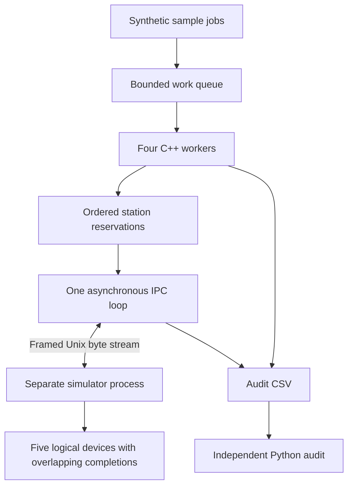

# LabLine

**Shared stations. Clear outcomes. An audit trail you can explain.**

LabLine is a small C++17 lab-workflow simulator for learning software integration, concurrency and failure diagnosis. It sends synthetic sample jobs through two pumps, a heater, a handling arm and a camera-like station. Four workers share those stations while a separate simulator process communicates over Linux IPC.

A delayed reply creates a practical question: did the operation fail, or did its confirmation get lost? LabLine keeps that distinction visible. It retries with the same request ID, checks workflow records independently, and stops issuing work when execution is uncertain.

> **Scope:** synthetic devices and fake sample IDs only. No physical hardware, real UART, patient data, images, ROS 2, clinical integration or hard real-time guarantees.

## Start here

On Linux or WSL2 Ubuntu 24.04, install GCC, CMake, make and Python 3.11+ once. From this folder:

```bash
bash scripts/run_all.sh
```

This builds, runs 17 CTest cases and executes 23 measured runs: 18 paired serial/concurrent workloads plus five fault/boundary scenarios. It writes a fresh timestamped evidence folder and prints its report location. No Python packages are needed.

**Included captured results:** [verification matrix](evidence/VERIFICATION.md), [experiment report](evidence/REPORT.md), [raw results](evidence/results.csv). These are local Linux results; a checked-in CI workflow is not a hosted CI pass.

## What is worth demonstrating

- Multiple jobs overlap independent station operations, while exclusive stations and the arm/heater pair remain protected.
- A binary framed stream handles split reads, CRC errors and duplicate requests across a real process boundary.
- Lost replies cause bounded retries; exhausted retries and disconnects produce explicit failed/unknown accounting.
- An independent Python checker finds missing, reordered and duplicate records in separate negative-control copies.
- The unsafe deadlock example is killed by an external timeout. The safe version finishes; it never attempts to unlock another thread's mutex.



## Windows 11 / WSL2 setup

In **PowerShell as Administrator**, install Ubuntu (restart if prompted):

```powershell
wsl --install -d Ubuntu-24.04
```

Open Ubuntu and finish its first-run username/password setup. Save the supplied ZIP in your Windows Downloads folder. In Ubuntu:

```bash
sudo apt update
sudo apt install -y build-essential cmake python3 unzip
windows_profile="$(cmd.exe /C echo %USERPROFILE% 2>/dev/null | tr -d '\r')"
windows_downloads="$(wslpath "$windows_profile")/Downloads"
mkdir -p "$HOME/labline-project"
unzip "$windows_downloads/LabLine-Morphle-AIT-Final.zip" -d "$HOME/labline-project"
cd "$HOME/labline-project/labline"
cmake -S . -B build -DCMAKE_BUILD_TYPE=Release
cmake --build build --parallel
ctest --test-dir build --output-on-failure
bash scripts/run_all.sh
```

These commands assume the ZIP keeps its supplied filename and is in the default Downloads folder. For a redirected Downloads folder, unzip it in Windows and copy the extracted `labline` folder to your Ubuntu home. Windows/WSL2 launch itself was **not executed** in this Linux environment.

View the included report with `cat evidence/REPORT.md`. Run `explorer.exe .` from Ubuntu to open this directory in Windows; open Markdown in VS Code and CSV in Excel. The experiment folder contains each run's `events.csv`, `simulator.csv`, `jobs.csv`, `summary.csv`, audit result and command metadata.

## Small demonstrations

```bash
# 10 jobs with four workers
./build/labline --jobs 10 --workers 4 --out audit/demo --run-id demo
python3 python/audit_check.py audit/demo/events.csv --summary audit/demo/summary.csv

# Lost ACK: one action despite retry
./build/labline --fault ack --out audit/ack --run-id ack

# Corrupt reply, then valid retry
./build/labline --fault crc --out audit/crc --run-id crc

# Slow heater
./build/labline --fault slow --out audit/slow --run-id slow

# Crash intentionally exits 2 after accounting for failed jobs
./build/labline --fault crash --out audit/crash --run-id crash

# Isolated unsafe timeout then safe completion
python3 tests/integration.py build/labline deadlock
```

Application exit codes: 0 all jobs DONE; 2 one or more jobs FAILED; 1 startup/configuration error. UNKNOWN is a subset of FAILED. Each invocation replaces files in its chosen `--out` directory; use a new directory for evidence you want to retain. `run_all.sh` chooses a fresh directory automatically.

## Build and sanitizer checks

```bash
cmake -S . -B build-debug -DCMAKE_BUILD_TYPE=Debug
cmake --build build-debug --parallel
ctest --test-dir build-debug --output-on-failure

cmake -S . -B build-asan -DCMAKE_BUILD_TYPE=Debug -DLABLINE_ASAN=ON
cmake --build build-asan --parallel
ctest --test-dir build-asan --output-on-failure

cmake -S . -B build-tsan -DCMAKE_BUILD_TYPE=Debug -DLABLINE_TSAN=ON
cmake --build build-tsan --parallel
ctest --test-dir build-tsan --output-on-failure
```

ASan and TSan must be separate. The supplied ASan+UBSan build succeeded, but its default test run was blocked by LeakSanitizer process-inspection errors; no leak check was disabled. TSan's final 17-case run passed after replacing timed-mutex operations with ordinary mutexes and bounded try-lock waits. That is evidence for these runs, not proof that every possible schedule is race-free.

The optional deliberately racy executable is off by default:

```bash
cmake -S . -B build-race -DCMAKE_BUILD_TYPE=Debug -DLABLINE_TSAN=ON -DLABLINE_UNSAFE_RACE=ON
cmake --build build-race --target unsafe_race_demo
./build-race/unsafe_race_demo
```

A nonzero sanitizer exit is expected for this isolated example. A real diagnostic is retained in `evidence/unsafe_race.log`.

## Read the implementation in this order

1. `src/controller.cpp`: job workflow, station reservations and terminal accounting.
2. `src/transport.cpp`: pending promises, nonblocking poll, retries and shutdown.
3. `src/simulator.cpp`: scheduled completions and request deduplication.
4. `src/protocol.cpp`: byte framing and CRC.
5. `python/audit_check.py`: independent consistency checks.

[Design and exact protocol](docs/DESIGN.md) · [Research and caveats](docs/RESEARCH_BASIS.md) · [Injected failure reports](docs/ROOT_CAUSE_REPORTS.md) · [Interview walkthrough](docs/INTERVIEW_GUIDE.md) · [JD evidence map](docs/KEYWORD_EVIDENCE.md) · [Complete file listing](docs/FILE_TREE.txt)

## Tradeoffs and honest limits

This project uses a bounded queue, four workers and simple mutex ordering instead of a scheduler framework. Devices are deterministic delay models; host timing and worker interleaving are not deterministic. Logs are flushed synchronously and their overhead is included. Dedup is memory-only, capped at 512 requests; supported workloads stop at 100 jobs/400 commands. There is no crash recovery, durable transaction system, hardware-in-the-loop or regulatory claim.

This source was newly generated with AI assistance for this request; no existing VitalWatch, FirmwareKit-C or EventPulse source was supplied or reused. It is not evidence that the candidate personally authored every line. Review, run and understand it before presenting your contribution in an interview. Code is offered under [MIT](LICENSE); cited papers retain their own licenses and are linked, not redistributed.
