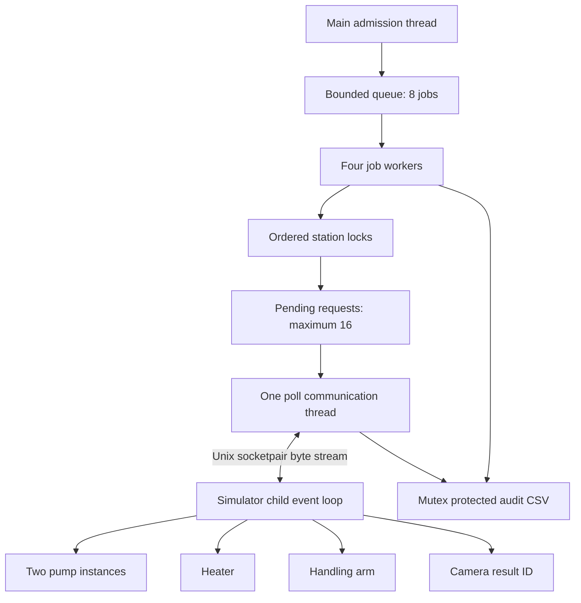

# Design: one controller, one simulator, five logical devices

## Process and thread layout

The parent calls `fork()` while still single-threaded. The child closes socket 0; the parent closes socket 1. The child runs `simulator()` directly, with no exec and no inherited audit stream. Child returns from simulator (flushing its local CSV destructor), closes its socket and calls `_exit`. Parent closes/shuts down its socket and waits up to about 200 ms, then kills/reaps an unresponsive child. This is a standalone application: embedding it in an already multithreaded process is unsupported.

The simulator is a single poll-driven scheduler with a due-time table. A delay never blocks its input loop. It owns a busy bit per device, a dedup map and its own log, so those structures need no cross-thread locks. Parent and child logs have separate steady-clock origins; compare intervals within each file, not raw timestamps across files.

## Workflow and station reservation

`RECEIVED → STAINED → HEATED → PLACED → IMAGED → DONE`, with FAILED allowed from any nonterminal state. Every accepted job has one TERMINAL event. UNKNOWN is a classification within FAILED, not a third additive count.

| Operation | Station IDs reserved by controller | Simulator command | Result |
|---|---|---|---|
| Stain | Either pump 2 or 3 | 1 | STAINED |
| Heat | Heater 4 | 2 | HEATED |
| Place heated tray | Arm 1 then heater 4 | 3 to arm | PLACED |
| Image | Camera 5 | 4 | IMAGED and then DONE |

This is a deliberately simplified educational sequence, not a validated physical lab process. Placement reserves the heater as the tray's source while the arm moves it. Simulator enforces exclusive use of the addressed device; the controller enforces the two-resource placement reservation.

Locks are ascending by numeric ID. The only two-lock operation takes arm 1 before heater 4; RAII releases both after confirmation or failure. Pump selection tries either without ever holding one while waiting for the other. Reservation wait is at most 5 seconds per operation; no fairness guarantee is made.

## Ownership of shared mutable state

| State | Owner/synchronization |
|---|---|
| Work queue and closed flag | Queue mutex + condition variable; capacity 8; close wakes waiters |
| Job array element | Admission initializes before queue publication; sole dequeuing worker owns it; main reads only after joins |
| Station ownership | Five mutexes with deadline-bounded try_lock loops; global ascending acquisition order |
| Request sequence, pending promises, stopped flag | Transport mutex; map maximum 16 |
| Decoder, transport counters and latency vector | Communication thread; main reads after `stop()` joins |
| Parent socket I/O | Communication thread sends/receives; shutdown under transport mutex; final close after join |
| Audit stream and its monotonic event ordering | Audit mutex, always a leaf lock |
| Simulator action map, busy flags and log | Child event loop only |

Workers may hold station locks then briefly take transport mutex then audit mutex. No path takes these in reverse. Admission's audit call returns before queue lock is acquired. Queue lock is released before worker processing. A worker never holds the transport mutex while waiting on its future. No worker acquires another station after entering transport.

## Protocol specification

UART-inspired framing over software-only Unix IPC. It is **not** a UART driver.

| Offset | Field | Width | Definition |
|---:|---|---:|---|
| 0 | START | 1 | A5 |
| 1 | version | 1 | 01 |
| 2 | length | 2 | Big endian payload byte count, 0–64 |
| 4 | sequence | 4 | Big endian, starts at 1 in each new controller process |
| 8 | device | 1 | 1 arm, 2/3 pumps, 4 heater, 5 camera |
| 9 | operation | 1 | 1 stain, 2 heat, 3 place, 4 image, 80 ACK, 81 NACK (hex for responses) |
| 10 | payload | length | Request: 4-byte big endian job ID. Reply: job ID plus 4-byte synthetic result ID |
| 10+length | CRC32 | 4 | Big endian reflected IEEE CRC32, polynomial EDB88320, initial/final XOR FFFFFFFF |
| 14+length | END | 1 | 5A |

CRC covers version through the last payload byte (offset 1, length 9+payload length). Total frame length is 15+payload length. `evidence/frame_example.txt` contains a measured encoder example; Python tests independently implement the same wire format using struct/zlib.

The decoder retains at most one maximum-size frame, handles one-byte feeds and concatenated frames, rejects bad version/oversized length/CRC/end marker, and scans again for START after rejection. END is never used as a delimiter. Corruption into an apparently valid length can delay parsing until that candidate is complete; finite request timeout bounds the effect. No assumption of one read per frame. Bad requests are dropped before action creation, with no device-state mutation; recovery is tested with the next valid frame. The controller counts bad response CRCs. Simulator input CRC counts are local parser state; input safety is independently asserted via no START in its action log.

## Request lifecycle and ambiguity

One outstanding command per worker; pending map cap 16. The communication loop checks pending commands, writes with nonblocking send/poll (50 ms send bound), reads nonblocking responses with poll, and resolves promises. Command timeout is 80 ms per attempt with at most two retries, using the **same sequence and payload**. Duplicate in-flight requests are ignored; completed duplicates receive cached replies. A reused sequence with different content gets NACK. Dedup storage is bounded at 512 entries and never evicted during a run; maximum workload is 100×4=400 actions. Over-capacity/new conflicting requests are rejected.

If all replies are lost, the action may already have executed. Exhausting retries shuts down the entire transport and resolves every pending promise as unknown. No new commands are issued; queued jobs fail as not issued. This conservative run abort avoids releasing a station and subsequently issuing work into a device whose prior execution is uncertain. Disconnect uses the same policy. Already confirmed completed jobs remain DONE. No child restart or persistence exists; dedup does not survive crashes.

Soft timing bounds are not hard scheduling guarantees. The event loop can briefly hold the transport mutex while bounded writes/logging occur. Logging I/O, OS starvation, catastrophic allocation failure, thread creation failure, forced controller termination and disk-full conditions are outside the injected fault model; they are not claimed to preserve complete audit accounting.

## Reproducibility and metrics

Device delay in milliseconds is `3 + (seed + job_id*7 + operation*11) % 5`. Slow mode adds 45 ms to each heater command. Job 1's first stain targets ACK loss, CRC reply corruption or crash, making logical fault selection independent of worker scheduling. `timeout` extends ACK loss to all replies for that command to exercise exhausted retries.

Measurements use `steady_clock`. Queue wait starts at admission before bounded push, so includes producer backpressure. Job time ends before TERMINAL logging. IPC time includes retries but excludes commands with no final response. Jitter is population standard deviation across mixed command response times. Percentiles use nearest rank. General-purpose Linux provides only soft real-time observations.

## Unsafe demonstrations

`deadlock_demo --demo-deadlock=unsafe` is a separate executable. Each of two threads holds one station mutex, then a condition-variable rendezvous proves both are ready before requesting the opposite mutex. Python times out and kills the entire process. Safe mode takes arm then heater and finishes. There is no in-process recovery, forced mutex unlock or arbitrary sleep to cause the deadlock.

`unsafe_race_demo` is off by default and never linked to the controller. It intentionally has undefined behavior; only use in an isolated TSan build. A failed TSan runtime startup is not a captured race diagnostic.
