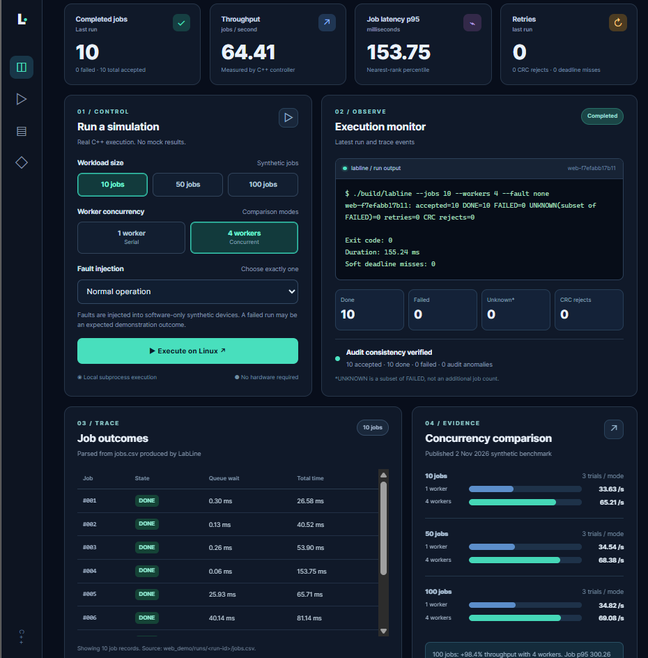
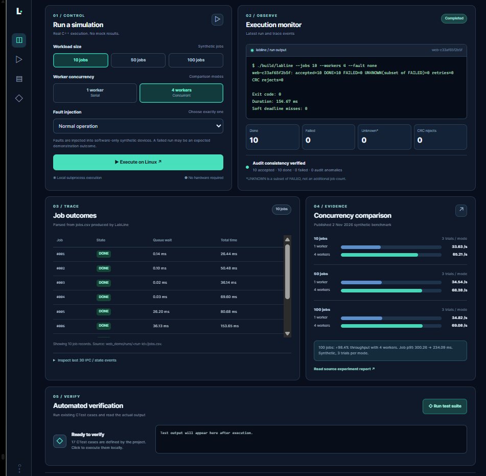
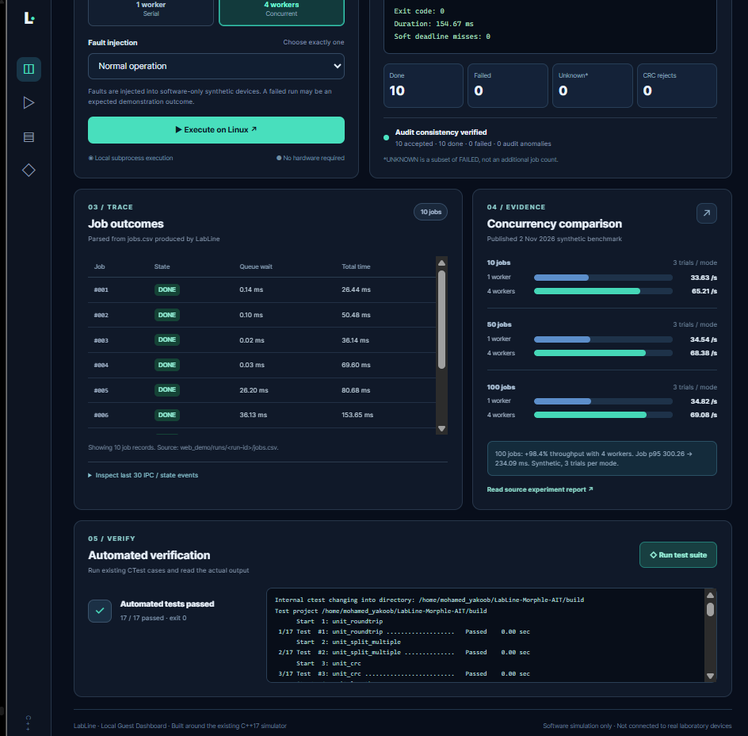
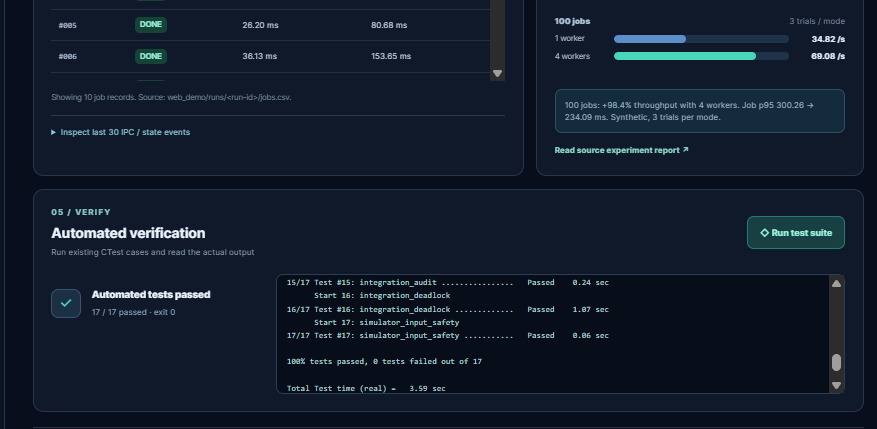

# LabLine Control Center — Web Dashboard Demonstration

LabLine is a **local, guest-access demonstration interface** for the existing C++17/Linux IPC laboratory workflow simulator. It executes the real compiled controller, reads generated CSV audit and job results, and displays reproducible benchmark evidence. **No sign-in is required.** The application is for synthetic devices and fake sample IDs only; it does not operate physical laboratory equipment.

## 1. Live simulation and execution monitor



**What this shows:** The dashboard invokes the C++ controller with **10 synthetic jobs, 4 workers and no injected fault**. In the captured run, all **10/10 jobs completed**, with **0 failed**, **0 unknown**, **0 retries**, **0 CRC rejections**, and **0 audit anomalies**. The C++ process measured **64.41 jobs/s** and **153.75 ms job p95 latency** for this single local execution. These are run-specific observations, not universal performance guarantees.

**Engineering relevance:** Worker concurrency, real Linux subprocess execution, IPC coordination, outcome accounting, and an independent CSV audit.

## 2. Job outcomes and measured concurrency evidence



**What this shows:** Each synthetic job has a terminal status, queue wait and total execution time, read from the actual `jobs.csv` produced by LabLine. The chart on the right displays **previously measured** synthetic benchmark results (three paired trials per mode), **not** the most recent run:

| Workload | 1 worker | 4 workers |
|---|---:|---:|
| 10 jobs | 33.63 jobs/s | 65.21 jobs/s |
| 50 jobs | 34.54 jobs/s | 68.38 jobs/s |
| 100 jobs | 34.82 jobs/s | 69.08 jobs/s |

For the 100-job workload, the four-worker mode achieved approximately **98.4% higher measured throughput** and reduced mean p95 job latency from **300.26 ms to 234.09 ms** in this controlled synthetic comparison. See [the dated experiment report](../evidence/REPORT_2026-11-02.md) for methodology and limitations.

**Engineering relevance:** Mutex-protected shared-station access, multi-threaded execution, performance measurement, and clear separation of live versus historical results.

## 3. Automated verification initiated from the browser



**What this shows:** The **Run test suite** control runs the existing CTest suite locally, instead of displaying a hard-coded success message. The dashboard shows **17/17 passed** and the underlying console output. The tests cover protocol parsing, concurrency, audit consistency, and failure handling.

**Engineering relevance:** Repeatable C++ integration and regression verification.

## 4. Final verification result



**What this shows:** The terminal output ends with **“100% tests passed, 0 tests failed out of 17”**. The captured local run completed in **3.59 seconds**. This is a real locally executed test result, not a claim about production hardware or every possible thread schedule.

## Additional fault demonstrations

The dashboard can run software-only fault scenarios (lost acknowledgment, CRC corruption, slow response, simulator crash, and timeout) using the compiled C++ CLI. Each scenario is intended to show bounded retries, explicit terminal states and audit evidence. **No fault-injection screenshot is included here yet**, because the supplied screenshots document normal execution and CTest only. The source implementation and dated experiment report contain the existing fault evidence.

## Launch locally

Prerequisites: Linux or WSL2 Ubuntu, an already built `build/labline` executable, and Python 3.11+.

```bash
cd ~/LabLine-Morphle-AIT
bash web_demo/start.sh
```

Open **http://127.0.0.1:8765** in a browser that can reach the WSL server.

> **Security and scope:** The dashboard starts local processes and has **no authentication**. Keep it local-only. Do not expose port 8765 or deploy this execution endpoint publicly without adding authentication and request controls. The screenshots show software-only synthetic results.

**Repository:** [LabLine-Morphle-AIT](https://github.com/yusufthecoder474/LabLine-Morphle-AIT) · **Evidence:** [November 2, 2026 benchmark report](../evidence/REPORT_2026-11-02.md)
