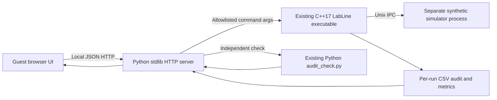

# LabLine Control Center — Guest Dashboard

A **zero-dependency Python + HTML/CSS/JavaScript** web interface for the existing [LabLine-Morphle-AIT](https://github.com/yusufthecoder474/LabLine-Morphle-AIT) C++17/Linux IPC application. It does not replace, simulate, or modify the verified C++ controller. The backend launches the **actual** `build/labline` executable and parses its generated CSV evidence.

## Start on Windows 11 + WSL2 Ubuntu 24.04

1. Download `LabLine-Web-Dashboard.zip` to the Windows **Downloads** folder.
2. In Ubuntu, run (the username and Downloads location below are for the existing Windows setup):

```bash
cd ~/LabLine-Morphle-AIT
unzip -o "/mnt/c/Users/Mohamed Yakoob/Downloads/LabLine-Web-Dashboard.zip"
bash web_demo/start.sh
```

3. Open **http://localhost:8765** in Chrome on Windows. No account, password, Node.js, npm, pip or React build required.
4. Click **Execute on Linux**, choose a fault scenario, and click **Run test suite**.
5. Stop the local server with `Ctrl+C` in Ubuntu.

If your Windows Downloads folder differs, find it with `explorer.exe .` or change the ZIP path. If `unzip` is missing, install once: `sudo apt install -y unzip`.

## Relevant features

- Real C++ job execution: 10 / 50 / 100 jobs with 1 or 4 workers and seed 42.
- Fault injection: `none`, `ack`, `crc`, `slow`, `timeout`, `crash`. Failure is visible and not incorrectly labeled success.
- Live *on-demand* execution output, job outcomes, queue and latency timings, recent event trace.
- Independent audit consistency check via the existing `python/audit_check.py`.
- Existing 17-case CTest suite runs from the browser (no claims about results until it runs).
- Historical 1-vs-4-worker comparison parsed from `evidence/REPORT_2026-11-02.md`, labeled as **previously measured synthetic evidence**.

## Architecture



## Limitations and safety

- **Local guest access only:** the server binds to `127.0.0.1`; no authentication and no permanent guest credentials. Never expose the local execution endpoint publicly, reverse-proxy it, or use public tunneling.
- Strict allowlists prevent arbitrary command names, paths and shell execution. The server checks the local origin for POST requests.
- All jobs are **synthetic**. This is not real hardware, clinical use, hard real-time control or a medically validated system.
- A simulator crash intentionally returns exit code 2; this indicates failed jobs and is a valid *fault demo* outcome. UNKNOWN counts within FAILED.
- The performance report is static experimental evidence, not live production telemetry.
- New runs are saved under `web_demo/runs/` and ignored by the accompanying `.gitignore`. Files in the run folder contain generated outputs, not user credentials.
- `ctest` runs the existing tests when the browser button is clicked. The dashboard cannot certify performance, safety or unseen schedules.
- Uses Python 3.11+ only. Tested here with the HTTP API and a small **fake CLI fixture**, not with your built C++ binary in WSL2. Run the steps on your own Ubuntu machine to validate real integration before recording.

## Recording walkthrough (around 2 minutes)

1. Explain that a queue submits synthetic lab jobs to C++ workers and a separate Unix IPC simulator.
2. Use **10 jobs / 4 workers / Normal**. Explain successes and job table.
3. Use **10 jobs / 4 workers / Lost acknowledgment**. Show `retries` and the independent audit outcome.
4. Use **10 jobs / 4 workers / Corrupt CRC frame**. Show `CRC rejects` and recovery.
5. Open performance chart: 100-job mean 34.82 vs 69.08 jobs/s in three paired synthetic runs. Explicitly distinguish this *historical* evidence from the interactive simulation.
6. Click **Run test suite** and point out the actual passed/failed count.

## Run the local web backend tests

```bash
python3 -m py_compile web_demo/server.py
```

No third-party packages are required.
